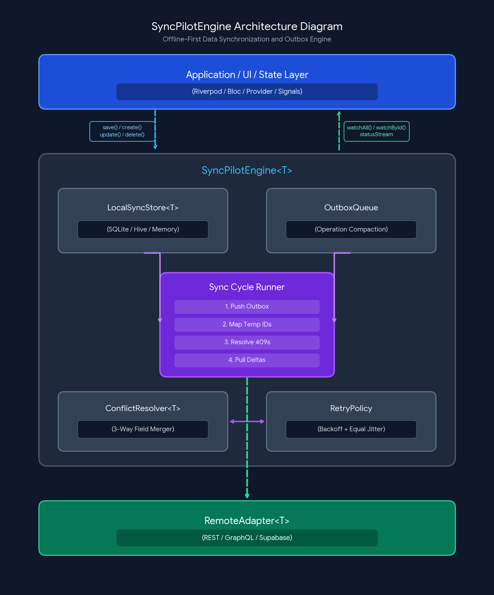

# sync_pilot

[](https://dart.dev)
[](https://pub.dev)
[%20%7C%20Windows%20%7C%20macOS%20%7C%20Linux-5c2d91.svg)](https://flutter.dev)
[](LICENSE)

**`sync_pilot`** is a database-agnostic, backend-agnostic, offline-first synchronization engine for Dart and Flutter applications.

It decouples synchronization orchestration from your local database and remote API. You can pair any local storage engine (**SQLite, `sqflite`, Drift, Hive, Isar, `SharedPreferences`, or in-memory**) with any backend (**REST, Dio, `package:http`, GraphQL, Supabase, Firebase, Appwrite, PocketBase, or gRPC**) while `sync_pilot` manages optimistic mutations, outbox compaction, temporary ID mapping, 3-way field-level conflict resolution, delta pagination, and exponential backoff retries.

---

## Table of Contents

1. [Motivation](#motivation)
2. [Core Capabilities](#core-capabilities)
3. [Architecture and Sync Lifecycle](#architecture-and-sync-lifecycle)
4. [Installation](#installation)
5. [Quick Start](#quick-start)
6. [Smart Outbox Compaction](#smart-outbox-compaction)
7. [Optimistic Temporary ID Mapping and Foreign Keys](#optimistic-temporary-id-mapping-and-foreign-keys)
8. [Conflict Resolution Strategies](#conflict-resolution-strategies)
9. [Storage Adapters (SQLite, Drift, Hive, SharedPreferences)](#storage-adapters-sqlite-drift-hive-sharedpreferences)
10. [Remote Transport Adapters (REST, Dio, HTTP, GraphQL)](#remote-transport-adapters-rest-dio-http-graphql)
11. [Batch Push and Idempotency](#batch-push-and-idempotency)
12. [Multi-Entity Relational Sync (`SyncCoordinator`)](#multi-entity-relational-sync-synccoordinator)
13. [At-Rest Encryption and Compression (`SyncPayloadCodec`)](#at-rest-encryption-and-compression-syncpayloadcodec)
14. [Reactive Flutter UI Integration](#reactive-flutter-ui-integration)
15. [Engine Configuration Reference](#engine-configuration-reference)
16. [License](#license)

---

## Motivation

Building a reliable offline-first application requires solving several subtle distributed-systems problems on the client:

* **Redundant offline mutations**: A user creates a draft offline, edits it five times, or deletes it before connectivity returns. Naive queues send six separate HTTP requests (or fail when trying to delete a record that never existed on the server).
* **Temporary client IDs (`temp_123` -> `srv_999`)**: Records created offline use temporary IDs. When the server assigns a permanent database ID, local records, queued updates, and child foreign keys must be rewritten atomically.
* **Concurrent edits and data loss**: Overwriting an entire JSON document during sync wipes out changes made by other devices to unrelated fields.
* **Vendor lock-in**: Existing sync solutions often require a specific cloud backend or force a specific local ORM.

`sync_pilot` solves these problems in pure Dart with **zero external runtime dependencies**, ensuring full compatibility across Mobile, Desktop, Web (including Flutter WebAssembly / WASM), and Dart CLI/Server environments.

---

## Core Capabilities

| Capability | Description |
| :--- | :--- |
| **Optimistic Local CRUD** | Reads and writes execute directly against `LocalSyncStore<T>` with zero network latency and emit updates via `watchAll()` and `watchById()`. |
| **Smart Outbox Compaction** | Automatically squashes redundant `create`, `update`, and `delete` operations targeting the same entity in `OutboxQueue`. |
| **Optimistic ID Mapping** | Replaces temporary offline IDs (`temp_123`) with server-assigned IDs (`srv_999`) across local storage, pending outbox entries, and child foreign keys. |
| **3-Way Field-Level Merge** | Tracks modified fields (`changedFields`) and base snapshots (`basePayload`) to merge concurrent client and server edits without losing data. |
| **Paginated Delta Sync** | Pulls incremental changes (`upserted` and `deletedIds`) using opaque checkpoints (timestamps, cursors, or sequence tokens) while protecting unpushed local edits. |
| **Batch Push** | Optionally groups pending operations into configurable chunks (`pushBatchSize`) to minimize HTTP round-trips. |
| **Resilient Retry Policy** | Distinguishes transient network/`5xx` failures from permanent `4xx` errors and retries using exponential backoff with equal jitter. |
| **At-Rest Security (`SyncPayloadCodec`)** | Pluggable, chainable encoding pipeline for encrypting and compressing local store and outbox payloads at rest. |

---

## Architecture and Sync Lifecycle



---

## Installation

Add `sync_pilot` to your `pubspec.yaml`:

```yaml
dependencies:
  sync_pilot: ^0.1.0
```

Then run:

```bash
dart pub get
```

---

## Quick Start

```dart
import 'package:sync_pilot/sync_pilot.dart';

class Todo {
  const Todo({
    required this.id,
    required this.title,
    required this.completed,
    required this.updatedAt,
  });

  factory Todo.fromJson(Map<String, Object?> json) => Todo(
        id: json['id']! as String,
        title: json['title']! as String,
        completed: (json['completed'] as bool?) ?? false,
        updatedAt: DateTime.parse(json['updatedAt']! as String).toUtc(),
      );

  final String id;
  final String title;
  final bool completed;
  final DateTime updatedAt;

  Map<String, Object?> toJson() => <String, Object?>{
        'id': id,
        'title': title,
        'completed': completed,
        'updatedAt': updatedAt.toUtc().toIso8601String(),
      };
}

Future<void> main() async {
  final engine = SyncPilotEngine<Todo>(
    entityName: 'todos',
    getId: (todo) => todo.id,
    toJson: (todo) => todo.toJson(),
    fromJson: Todo.fromJson,
    localStore: InMemorySyncStore<Todo>(getId: (todo) => todo.id),
    conflictResolver: ConflictResolver<Todo>.fieldLevelMerge(
      fromJson: Todo.fromJson,
    ),
    remoteAdapter: CallbackRemoteSyncAdapter<Todo>(
      onPush: (operation) async {
        // Push CREATE, UPDATE, or DELETE to your remote backend
        return const PushOperationResult.success();
      },
      onPullDelta: (checkpoint) async {
        // Fetch records modified since `checkpoint`
        return const RemoteDeltaPage<Todo>(
          upserted: <Todo>[],
          deletedIds: <String>[],
          nextCheckpoint: '2026-11-07T12:00:00Z',
          hasMore: false,
        );
      },
    ),
  );

  // 1. Optimistic local mutations (work identically online and offline)
  await engine.save(
    Todo(
      id: 'temp_1',
      title: 'Draft specification',
      completed: false,
      updatedAt: DateTime.now().toUtc(),
    ),
  );

  // 2. Trigger synchronization manually (or automatically via reconnect/interval)
  final report = await engine.sync();
  print('Pushed: ${report.pushedCount}, Pulled: ${report.pulledUpsertedCount}');

  await engine.dispose();
}
```

---

## Smart Outbox Compaction

When a device is offline, users frequently perform multiple mutations on the same record before connectivity returns. `OutboxQueue` automatically compacts mutations targeting the same `entityId` in place:

| Existing Queued Operation | Incoming Mutation | Resulting Queued Operation | Network Impact |
| :--- | :--- | :--- | :--- |
| `create` | `update` (N times) | Single `create` with merged payload and accumulated `changedFields` | Saves N `PATCH`/`PUT` requests |
| `create` | `delete` | **Eliminated completely** (removed from queue) | **0 requests sent (100% saved)** |
| `update` | `update` (N times) | Single `update` with merged payload and union of `changedFields` | Saves N - 1 `PATCH`/`PUT` requests |
| `update` | `delete` | Single `delete` operation (payload cleared) | Saves 1 `PATCH`/`PUT` request |
| `delete` | `create` | Single `update` operation with new payload | Collapses delete + re-create into 1 request |

To inspect how many redundant operations were eliminated during a sync cycle, check `report.compactedCount`.

---

## Optimistic Temporary ID Mapping and Foreign Keys

Offline-first applications often assign temporary client IDs (such as `'temp_order_1'`) when creating records offline. Once the `create` operation is pushed, the backend may return a canonical server-generated ID (such as `'srv_order_9001'`).

When `RemoteSyncAdapter` returns `PushOperationResult.success(serverRecord: createdOnServer)` with a new ID, `SyncPilotEngine` automatically performs four actions:

1. **Local Store Replacement**: Deletes `'temp_order_1'` from `LocalSyncStore` and upserts `'srv_order_9001'`.
2. **Outbox Rewriting**: Scans all remaining operations in `OutboxQueue` and replaces `'temp_order_1'` with `'srv_order_9001'` in `entityId`, `payload`, and `basePayload` (including nested maps and lists).
3. **Transparent Lookup Resolution**: Calling `engine.getById('temp_order_1')`, `engine.watchById('temp_order_1')`, or `engine.resolveId('temp_order_1')` automatically resolves to `'srv_order_9001'`.
4. **Event Notification**: Emits an `IdMappingEvent` on `engine.idMappingStream` and records the mapping in `SyncCycleReport.idMappings`.

```dart
engine.idMappingStream.listen((event) {
  print('Mapped ${event.temporaryId} -> ${event.permanentId}');
});
```

---

## Conflict Resolution Strategies

Conflicts occur either during **Push** (when the server responds with HTTP `409 Conflict` / `412 Precondition Failed` and returns `PushOperationResult.conflict(remoteRecord: ...)`) or during **Pull** (when a delta page contains a record that still has unpushed local modifications).

`ConflictResolver<T>` provides five built-in strategies:

### 1. 3-Way Field-Level Merge (Recommended)

Compares `localJson` and `remoteJson` against `baseJson` (the snapshot captured before offline edits began) and `pendingOperation.changedFields`. Non-overlapping field edits from both client and server are preserved automatically.

```dart
final resolver = ConflictResolver<Todo>.fieldLevelMerge(
  fromJson: Todo.fromJson,
  preferLocalOnFieldCollision: true,
  alwaysKeepRemoteFields: const <String>{'id', 'createdAt', 'version'},
);
```

### 2. Last-Write-Wins (Timestamp Comparison)

Compares UTC timestamps extracted from the local and remote records:

```dart
final resolver = ConflictResolver<Todo>.lastWriteWins(
  timestampExtractor: (todo) => todo.updatedAt,
  preferRemoteOnTie: true,
);
```

### 3. Server Wins / Client Wins

```dart
final serverWins = ConflictResolver<Todo>.serverWins();
final clientWins = ConflictResolver<Todo>.clientWins();
```

### 4. Custom Synchronous or Asynchronous Resolver

Implement domain-specific merge rules or prompt the user via a dialog before returning a `ConflictResolution<T>`:

```dart
final customResolver = ConflictResolver<Todo>.custom((context) async {
  final local = context.localItem;
  final remote = context.remoteItem;

  if (local == null) {
    return ConflictResolution.useRemote(remote);
  }

  // Return UseRemote, UseLocal, UseMerged, or DeferConflict
  final merged = Todo(
    id: remote.id,
    title: local.title,
    completed: local.completed || remote.completed,
    updatedAt: DateTime.now().toUtc(),
  );
  return ConflictResolution.useMerged(merged);
});
```

---

## Storage Adapters (SQLite, Drift, Hive, SharedPreferences)

### 1. SQLite / `sqflite` / `sqlite3` / `Drift` (`SqlSyncStore` & `SqlOutboxStorage`)

`SqlSyncStore` and `SqlOutboxStorage` work with any SQL database through `CallbackSqlExecutor`. They automatically execute `CREATE TABLE IF NOT EXISTS` for your entity table, checkpoint table, and durable outbox table:

```dart
final sqlExecutor = CallbackSqlExecutor(
  onQuery: (sql, args) => database.rawQuery(sql, args),
  onExecute: (sql, args) => database.execute(sql, args),
);

final localStore = SqlSyncStore<Todo>(
  executor: sqlExecutor,
  tableName: 'todos',
  getId: (todo) => todo.id,
  toJson: (todo) => todo.toJson(),
  fromJson: Todo.fromJson,
);

final outbox = OutboxQueue(
  entityName: 'todos',
  storage: SqlOutboxStorage(executor: sqlExecutor),
);
```

### 2. Hive / `SharedPreferences` / Key-Value (`KeyValueSyncStore`)

Use `KeyValueSyncStore` (for map boxes) or `KeyValueSyncStore.fromJsonStrings` (for string boxes or `SharedPreferences`) to get a full reactive store with `watchAll()` and `watchById()` streams:

```dart
final localStore = KeyValueSyncStore<Todo>.fromJsonStrings(
  getId: (todo) => todo.id,
  toJson: (todo) => todo.toJson(),
  fromJson: Todo.fromJson,
  readAllStrings: () => Map<String, String>.from(todosBox.toMap()),
  readString: (id) => todosBox.get(id),
  putString: (id, json) => todosBox.put(id, json),
  deleteString: (id) => todosBox.delete(id),
  clearStrings: () => todosBox.clear(),
  readCheckpoint: (entity) => metaBox.get('cp_$entity'),
  writeCheckpoint: (entity, cp) => metaBox.put('cp_$entity', cp ?? ''),
);
```

### 3. Lightweight Outbox Persistence (`JsonStringOutboxStorage`)

Persist the outbox queue in any key-value store in two lines of code:

```dart
final outbox = OutboxQueue(
  entityName: 'todos',
  storage: JsonStringOutboxStorage(
    read: (key) async => sharedPrefs.getString(key),
    write: (key, value) async => sharedPrefs.setString(key, value),
  ),
);
```

---

## Remote Transport Adapters (REST, Dio, HTTP, GraphQL)

### 1. Standardized REST Adapter (`RestSyncAdapter`)

`RestSyncAdapter<T>` implements standard REST conventions over any HTTP client (`Dio`, `package:http`, `Chopper`, or `HttpClient`):

* `POST <basePath>` for `create`
* `PATCH <basePath>/<id>` for `update` (when `sendOnlyChangedFieldsOnPatch: true`, sends **only** the modified fields from `operation.changedFields`)
* `DELETE <basePath>/<id>` for `delete`
* `POST <basePath>/batch` for `pushBatch`
* `GET <basePath>?updated_after=<checkpoint>` for `pullDelta`
* Attaches `X-Idempotency-Key: <operation.id>` to every mutation request
* Automatically maps HTTP `200..299` to `PushSuccess`, `409`/`412` to `PushConflict`, `408`/`429`/`5xx` to `PushRetryableFailure`, and other `4xx` to `PushPermanentFailure`.

```dart
final remoteAdapter = RestSyncAdapter<Todo>(
  basePath: '/api/v1/todos',
  fromJson: Todo.fromJson,
  usePatchForUpdates: true,
  sendOnlyChangedFieldsOnPatch: true,
  checkpointQueryParam: 'updated_after',
  defaultHeaders: const <String, String>{
    'Authorization': 'Bearer <token>',
  },
  sendRequest: (request) async {
    final response = await dio.request<Object?>(
      request.path,
      data: request.body,
      queryParameters: request.queryParameters,
      options: Options(
        method: request.method.name.toUpperCase(),
        headers: request.headers,
        validateStatus: (_) => true,
      ),
    );
    return RestResponse(
      statusCode: response.statusCode ?? 500,
      body: response.data,
    );
  },
);
```

### 2. Custom / GraphQL / Supabase Adapter (`CallbackRemoteSyncAdapter`)

For non-REST backends, use `CallbackRemoteSyncAdapter<T>` or subclass `RemoteSyncAdapter<T>` directly:

```dart
final remoteAdapter = CallbackRemoteSyncAdapter<Todo>(
  onPush: (operation) async {
    // Execute Supabase / GraphQL / gRPC mutation
    return const PushOperationResult.success();
  },
  onPullDelta: (checkpoint) async {
    // Query records updated after `checkpoint`
    return const RemoteDeltaPage<Todo>(
      upserted: <Todo>[],
      deletedIds: <String>[],
      nextCheckpoint: 'cursor_token_102',
      hasMore: false,
    );
  },
);
```

---

## Batch Push and Idempotency

For applications that generate large volumes of offline records (such as field inspections, inventory scans, or POS transactions), enable batch pushing to send operations in chunks:

```dart
final engine = SyncPilotEngine<Todo>(
  entityName: 'todos',
  getId: (t) => t.id,
  toJson: (t) => t.toJson(),
  fromJson: Todo.fromJson,
  localStore: localStore,
  remoteAdapter: remoteAdapter,
  enableBatchPush: true,
  pushBatchSize: 25,
);
```

When `enableBatchPush: true` is set, `SyncPilotEngine` groups pending operations into batches of up to `pushBatchSize` and invokes `RemoteSyncAdapter.pushBatch(batch)`.

---

## Multi-Entity Relational Sync (`SyncCoordinator`)

When synchronizing relational entities (for example, `workspaces` -> `projects` -> `tasks`), parent records must be pushed before child records so foreign-key constraints are satisfied on the server.

`SyncCoordinator` runs engines sequentially in registration order and **automatically propagates optimistic temporary ID mappings** from parent engines to all child engines (rewriting foreign keys like `projectId: 'temp_proj_1'` to `'srv_proj_777'` in both the child local store and child outbox queue before the child engine pushes):

```dart
final coordinator = SyncCoordinator(
  engines: <SyncPilotEngine<Object?>>[
    workspacesEngine,
    projectsEngine,
    tasksEngine,
  ],
);

final reports = await coordinator.syncAll(stopOnFirstFailure: true);
```

---

## At-Rest Encryption and Compression (`SyncPayloadCodec`)

Applications handling sensitive financial, medical, or personal data can encrypt and/or compress payloads before they are written to SQLite, Hive, or `SharedPreferences` using `SyncPayloadCodec`.

Codecs can be chained into pipelines using `.then(...)` (applied forward on `encode` and in reverse order on `decode`):

```dart
final compressionCodec = SyncPayloadCodec.custom(
  encode: (plain) => myGzipCompressor.compressToString(plain),
  decode: (compressed) => myGzipCompressor.decompressFromString(compressed),
);

final aesEncryptionCodec = SyncPayloadCodec.custom(
  encode: (plain) async => myAesGcmCipher.encrypt(plain),
  decode: (cipherText) async => myAesGcmCipher.decrypt(cipherText),
);

// Compress first, then encrypt on write; decrypt first, then decompress on read
final secureCodec = compressionCodec.then(aesEncryptionCodec);

final sqlStore = SqlSyncStore<Todo>(
  executor: sqlExecutor,
  tableName: 'todos',
  getId: (t) => t.id,
  toJson: (t) => t.toJson(),
  fromJson: Todo.fromJson,
  codec: secureCodec,
);

final outbox = OutboxQueue(
  entityName: 'todos',
  storage: SqlOutboxStorage(
    executor: sqlExecutor,
    codec: secureCodec,
  ),
);
```

---

## Reactive Flutter UI Integration

`SyncPilotEngine` exposes streams designed for direct consumption in Flutter `StreamBuilder`, `Riverpod` `StreamProvider`, or `Bloc`:

```dart
// 1. Observe live entity list
StreamBuilder<List<Todo>>(
  stream: todoEngine.watchAll(),
  builder: (context, snapshot) {
    final todos = snapshot.data ?? const <Todo>[];
    return ListView.builder(
      itemCount: todos.length,
      itemBuilder: (context, index) => Text(todos[index].title),
    );
  },
);

// 2. Observe global sync phase and pending mutation count
StreamBuilder<SyncStatusSnapshot>(
  stream: todoEngine.statusStream,
  builder: (context, snapshot) {
    final status = snapshot.data;
    if (status == null) return const SizedBox.shrink();
    return Text(
      'Status: ${status.phase.name} | Pending: ${status.pendingCount}',
    );
  },
);

// 3. Query per-record sync state (synced, pendingCreate, pendingUpdate, pendingDelete, failed)
final recordState = await todoEngine.getRecordSyncState(todo.id);
```

---

## Engine Configuration Reference

| Parameter | Type | Default | Description |
| :--- | :--- | :--- | :--- |
| `entityName` | `String` | *Required* | Logical collection or table name (e.g. `'todos'`). |
| `getId` | `String Function(T)` | *Required* | Extracts the primary key from an entity instance. |
| `toJson` | `Map<String, Object?> Function(T)` | *Required* | Serializes an entity instance to a JSON map. |
| `fromJson` | `T Function(Map<String, Object?>)` | *Required* | Deserializes an entity instance from a JSON map. |
| `localStore` | `LocalSyncStore<T>` | *Required* | Local database adapter for optimistic reads and writes. |
| `remoteAdapter` | `RemoteSyncAdapter<T>` | *Required* | Remote transport adapter for push and delta pull. |
| `outbox` | `OutboxQueue?` | `OutboxQueue(entityName)` | Durable outbox queue with operation compaction. |
| `conflictResolver` | `ConflictResolver<T>?` | `ConflictResolver.serverWins()` | Strategy for resolving local/remote conflicts. |
| `connectivityMonitor` | `ConnectivityMonitor?` | `ManualConnectivityMonitor()` | Network state detector for pausing/resuming sync. |
| `retryPolicy` | `RetryPolicy` | `RetryPolicy()` (5 retries) | Exponential backoff and jitter configuration. |
| `syncInterval` | `Duration?` | `null` | Optional periodic background sync interval while online. |
| `autoSyncOnMutation` | `bool` | `false` | Triggers background `sync()` immediately after local mutations. |
| `autoSyncOnReconnect` | `bool` | `true` | Automatically triggers `sync()` when connectivity is restored. |
| `enableBatchPush` | `bool` | `false` | Pushes pending mutations in batches via `pushBatch`. |
| `pushBatchSize` | `int` | `20` | Maximum number of operations per batch request. |
| `maxDeltaPagesPerSync` | `int` | `50` | Safety cap on paginated delta pulls per sync cycle. |

---

## License

Released under the [MIT License](LICENSE).
